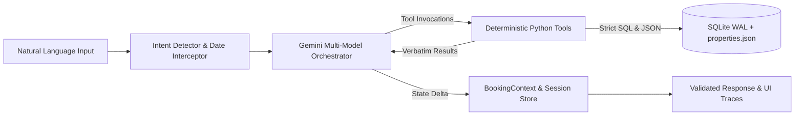
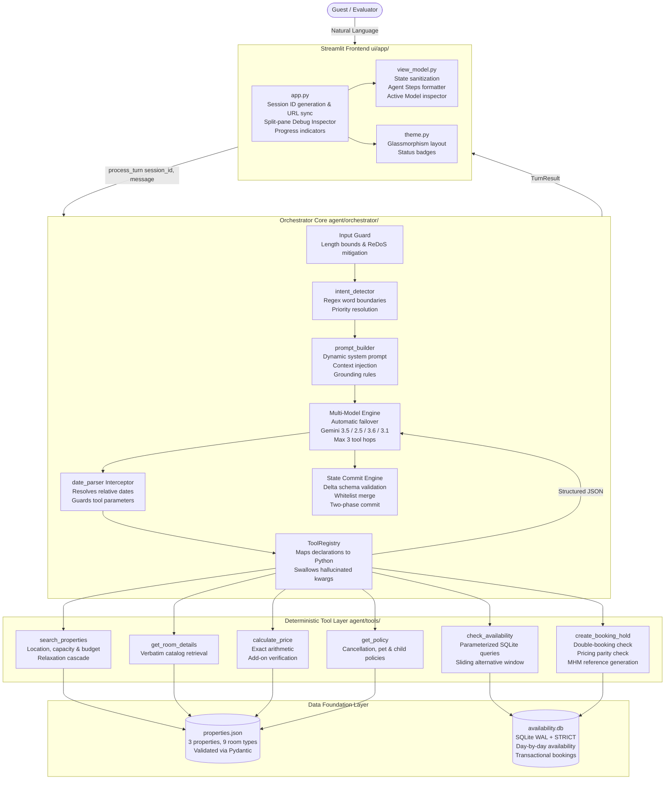
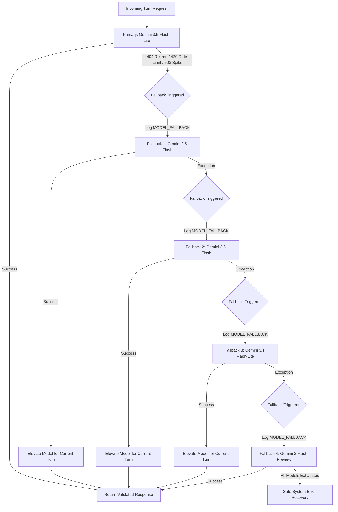
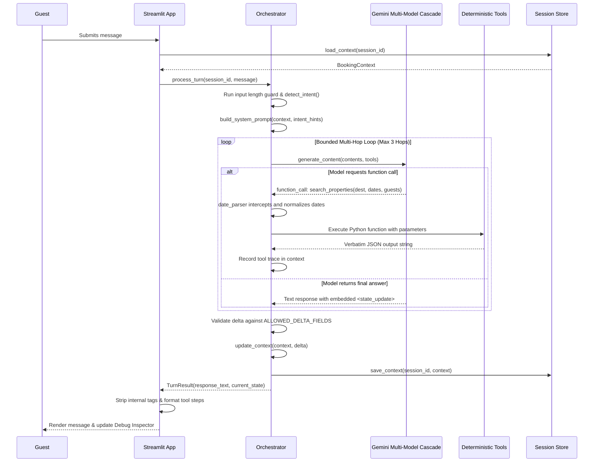
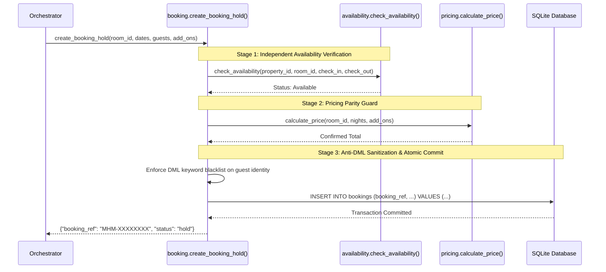

# Mehman Mira: Autonomous Hotel Booking Agent

[](https://mehmanmira.streamlit.app)
[](https://github.com/vm7151810/MehmanMira)
[](https://python.org)
[](https://ai.google.dev)
[](https://streamlit.io/)
[](https://sqlite.org)
[](https://docs.pydantic.dev/)
[](https://dateparser.readthedocs.io)
[](https://github.com/astral-sh/uv)
[](https://docs.pytest.org)
[](https://github.com/astral-sh/ruff)
[](LICENSE)

> **Live Interactive Demo**: [https://mehmanmira.streamlit.app](https://mehmanmira.streamlit.app)

An enterprise-grade, state-driven conversational reservation system designed to autonomously process complex, multi-turn hotel bookings. Mehman Mira couples conversational large language model orchestration with deterministic Python application logic, transactional SQLite inventory constraints, and automatic multi-model failover to eliminate price, inventory, and policy hallucinations.

---

## Table of Contents

- [Overview](#overview)
  - [The Core Problem](#the-core-problem)
  - [The Solution: LLM Reasons, Python Decides](#the-solution-llm-reasons-python-decides)
  - [Guaranteed Operational Boundaries](#guaranteed-operational-boundaries)
- [System Architecture](#system-architecture)
  - [High-Level Component Architecture](#high-level-component-architecture)
  - [Automatic Multi-Model Fallback Cascade](#automatic-multi-model-fallback-cascade)
  - [Per-Turn Execution Sequence](#per-turn-execution-sequence)
  - [Transactional Hold Safety Pipeline](#transactional-hold-safety-pipeline)
  - [Repository Structure](#repository-structure)
- [Core Engineering Features](#core-engineering-features)
  - [Pre-LLM Intent Routing and Date Normalization](#pre-llm-intent-routing-and-date-normalization)
  - [Strict Deterministic Tool Layer](#strict-deterministic-tool-layer)
  - [Multi-Hop State Engine and Persistence](#multi-hop-state-engine-and-persistence)
  - [Contextual Upselling Engine](#contextual-upselling-engine)
- [Live Demo & Evaluator Guide](#live-demo--evaluator-guide)
  - [Operational Dataset Scope](#operational-dataset-scope)
  - [Test Scenarios for Evaluators](#test-scenarios-for-evaluators)
  - [System Limitations](#system-limitations)
- [Quickstart & Local Execution](#quickstart--local-execution)
  - [Prerequisites](#prerequisites)
  - [Environment Setup](#environment-setup)
  - [Database Seeding](#database-seeding)
  - [Running the Streamlit UI](#running-the-streamlit-ui)
  - [Running the Interactive CLI](#running-the-interactive-cli)
- [Architecture Decision Records](#architecture-decision-records)

---

## Overview

Mehman Mira serves as the automated concierge for Mehman, a boutique hospitality platform. Guests interact using natural conversational phrasing ("a pool villa in North Goa for 4 guests next weekend under 20k per night with breakfast"). Mira guides the user from discovery to a confirmed reservation hold across corrections, interruptions, and changes of preference.

### The Core Problem

Standard LLM chatbot integrations fail in critical transaction workflows:
- Generating fictitious rates or calculating night totals incorrectly.
- Confirming reservations for blocked dates or non-existent inventory.
- Fabricating hotel amenities, check-in policies, or pet rules.
- Performing flawed arithmetic on relative temporal expressions ("next weekend").
- Losing typed conversational state across turns when inputs are ambiguous.

### The Solution: LLM Reasons, Python Decides

Mehman Mira enforces a strict division of responsibilities:
- **Language Models (Google Gemini API)** handle natural language understanding, conversational tone, and parameter extraction.
- **Deterministic Python & SQLite** own all state mutations, catalog lookups, dates, pricing calculations, and reservation commits.



### Guaranteed Operational Boundaries

| Domain | Enforcement Mechanism | System Guarantee |
|---|---|---|
| Property Amenities & Policies | search, details, and policy tools querying properties.json | Verbatim retrieval only; unlisted attributes (such as heated pools) are reported as unconfirmed. |
| Inventory & Availability | availability tool executing against SQLite in STRICT mode | Parameterized SQL queries; automatic calculation of alternative open windows upon conflict. |
| Rate & Add-On Pricing | pricing tool executing pure arithmetic | Totals are never calculated by the LLM; unauthorized add-ons are rejected. |
| Reservation Holds | booking tool with local re-verification | Atomic INSERT with anti-DML injection safeguards and independent capacity validation. |
| Temporal Expressions | Pre-tool date_parser interceptor | Conversational dates resolve to ISO-8601 against an explicit reference date; ambiguous holidays are rejected. |
| Conversational State | BookingContext dataclass + atomic disk persistence | Typed field validation, frozenset delta whitelisting, and crash-resilient disk serialization. |

---

## System Architecture

### High-Level Component Architecture



---

### Automatic Multi-Model Fallback Cascade

To eliminate outages caused by model deprecations, provider quota limits (HTTP 429), or upstream server capacity spikes (HTTP 503), the orchestrator incorporates an automatic multi-model failover engine. If a model endpoint is unavailable, the request cascades to the next active model without interrupting the user session.



---

### Per-Turn Execution Sequence



---

### Transactional Hold Safety Pipeline

The `create_booking_hold` tool enforces a three-stage zero-trust validation pipeline before writing to the database:



---

### Repository Structure

```
MehmanOS/
|-- agent/
|   |-- config/src/config.py              # Pydantic-settings configuration singleton
|   |-- logger/src/logger.py              # Structured JSON logging engine
|   |-- state/src/
|   |   |-- state.py                      # BookingContext interface & coercion
|   |   `-- components/models.py          # State domain dataclass & delta whitelist
|   |-- session_store/src/                # Thread-safe atomic session persistence
|   |-- intent_detector/src/              # Regex pre-classifier & ReDoS firewall
|   |-- date_parser/src/                  # NLP date normalizer (Asia/Kolkata reference)
|   |-- prompt_builder/src/               # Dynamic system prompt generator
|   |-- orchestrator/src/                 # Core loop, multi-model cascade & tool runner
|   `-- tools/
|       |-- search/src/                   # search_properties implementation
|       |-- availability/src/             # check_availability implementation
|       |-- details/src/                  # get_room_details implementation
|       |-- pricing/src/                  # calculate_price arithmetic engine
|       |-- policy/src/                   # get_policy implementation
|       `-- booking/src/                  # create_booking_hold implementation
|-- ui/app/src/
|   |-- app.py                            # Streamlit entry point with Debug Inspector
|   |-- view_model.py                     # State sanitizer & trace expander formatter
|   `-- theme.py                          # Glassmorphism dark styling
|-- data/
|   |-- properties/src/properties.json    # Curated hotel catalog & policies
|   `-- availability_db/src/              # SQLite database (availability.db)
|-- scripts/
|   `-- seed_db/src/seed_db.py            # Deterministic inventory seeding script
|-- eval/
|   `-- fixtures/                         # Test fixtures & validation loaders
|-- interactive_cli.py                    # Terminal conversational test utility
|-- requirements.txt                      # Project dependencies
`-- .env.example                          # Environment template
```

---

## Core Engineering Features

### Pre-LLM Intent Routing and Date Normalization

Two deterministic modules operate before and during model invocation:

1. **Intent Detector**:
   - Matches compiled word-boundary regular expressions (`\b(cancel|refund)\b`).
   - Guarded against ReDoS attacks by evaluating input length prior to regex processing.
   - Outputs a non-blocking soft intent hint (`SEARCH_AND_VALIDATE`, `GET_POLICY`, `STATE_UPDATE`) injected into the prompt.

2. **Date Interceptor**:
   - Intercepts all incoming temporal arguments in tool invocations before execution.
   - Converts natural expressions ("next weekend", "day after tomorrow", "Oct 16-18") into strict ISO-8601 calendar dates (`YYYY-MM-DD`).
   - Anchored to the `Asia/Kolkata` timezone with a deterministic reference date.
   - Vague expressions ("sometime next month") are rejected in-band, prompting the model to seek clarification.

---

### Strict Deterministic Tool Layer

The language model operates strictly as an orchestrator and cannot directly access underlying datastores.

- **Universal Exception Shielding**: Every tool is wrapped in exception containment blocks, returning structured JSON error payloads (`ERR_INVALID_DATES`, `ERR_CAPACITY_EXCEEDED`) instead of allowing unhandled tracebacks.
- **Hallucinated Argument Absorption**: All tool signatures accept `**kwargs` to prevent runtime `TypeError` exceptions if the model supplies superfluous arguments. Swallowed arguments are noted in an output warnings list.
- **Strict Decimal Arithmetic**: The `pricing` tool rounds all rates to 2 decimal places before computing totals, completely preventing penny-drift discrepancies.
- **DML Injection Firewall**: The booking engine sanitizes guest names and enforces strict parameter binding, barring commands containing SQL modification keywords.

---

### Multi-Hop State Engine and Persistence

Conversational state is governed by an explicit state machine:

- **Whitelisted Delta Merging**: The model outputs state changes wrapped in `<state_update>` tags. Updates are validated against `ALLOWED_DELTA_FIELDS`. System-owned fields (such as `tool_traces` and `conversation_history`) cannot be modified by the LLM.
- **Safe Type Coercion**: Field updates undergo type coercion (e.g., string `"4"` to integer `4`). Invalid types are rejected individually while preserving valid fields.
- **Atomic File Persistence**: Sessions are saved using `filelock` and atomic file renaming to prevent corruption during concurrent requests or browser refreshes.

---

### Contextual Upselling Engine

- The agent inspects `add_ons` mapped to the specific room selection (such as daily breakfast, private airport transfer, or late checkout).
- Add-ons are computed line-by-line via the `pricing` tool, preventing unverified charges.
- Pricing scales automatically across multi-night stays when requested by the guest.

---

## Live Demo & Evaluator Guide

### Operational Dataset Scope

The operational environment is pre-configured with three properties in Goa across a 92-day availability window (**October 1, 2026 to December 31, 2026**):

| Property ID & Name | Location | Rating | Available Rooms | Base Rate | Capacity | Key Policies & Add-Ons |
|---|---|:---:|---|:---:|:---:|---|
| **GOA001: The Dunes Retreat** | Calangute, North Goa | 4.5 / 5.0 | Deluxe Sea View<br>Family Suite<br>Private Pool Villa | ₹8,500<br>₹14,000<br>₹22,000 | 2 guests<br>4 guests<br>4 guests | Free cancellation up to 48 hours.<br>Breakfast, Airport Transfer.<br>**Note: Pool Villa blocked Oct 9-11.** |
| **GOA002: Emerald Gardens** | Assagao, North Goa | 4.2 / 5.0 | Garden Room<br>Cottage | ₹6,000<br>₹11,000 | 2 guests<br>3 guests | Pet-friendly.<br>Breakfast, Bicycle Rental.<br>**Note: Cottage scarcity on Oct 15-17.** |
| **GOA003: Taj Exotica Resort & Spa** | Benaulim, South Goa | 4.9 / 5.0 | Standard Room<br>Deluxe Room<br>Suite<br>Presidential Villa | ₹9,000<br>₹13,000<br>₹25,000<br>₹45,000 | 2 guests<br>2 guests<br>3 guests<br>6 guests | Children under 12 stay free.<br>Presidential Villa includes butler.<br>Spa, Luxury Van Transfer, Private Chef. |

---

### Test Scenarios for Evaluators

When exploring the live deployment, execute these scenarios to observe the system deterministic guarantees:

#### 1. Multi-Constraint Discovery & Capacity Filtering
* **Input**: `"I need a stay in North Goa from Oct 16 to 18 for 4 guests under 15,000 with sea view."`
* **Observed Behavior**: The agent executes `search_properties`. It filters out 2-guest rooms and over-budget options, identifying the **Family Suite at The Dunes Retreat** (₹14,000/night). The Debug Panel updates check-in, check-out, and guest count.

#### 2. Anti-Hallucination Grounding
* **Input**: `"Is the pool heated?"`
* **Observed Behavior**: The agent inspects `get_room_details`. Because pool heating is not specified in `properties.json`, the agent states that property records do not confirm this attribute, rather than assuming it is heated.

#### 3. Blocked Inventory & Alternative Windows
* **Input**: `"Can I reserve the Private Pool Villa at The Dunes Retreat from October 9 to October 11?"`
* **Observed Behavior**: The SQLite query returns zero available units for `GOA001-POOL`. The agent detects the conflict and calculates the next available open window (from October 12 onwards).

#### 4. Inventory Scarcity Notification
* **Input**: `"Check availability for the Cottage at Emerald Gardens from Oct 15 to Oct 17."`
* **Observed Behavior**: The database reflects exactly 1 remaining unit for those dates. The agent confirms availability and transparently reports high demand.

#### 5. Strict Add-On Arithmetic
* **Input**: `"Book the Family Suite for Oct 16 to 18 for 4 guests with Breakfast and Airport Transfer."`
* **Observed Behavior**: Python computes the exact total: `(₹14,000 × 2 nights) + ₹1,600 breakfast + ₹1,500 transfer = ₹31,100`. The LLM quotes the exact calculated breakdown.

#### 6. Reservation Commit & State Persistence
* **Input**: `"Confirm the reservation under the name Rajesh Kumar."`
* **Observed Behavior**: The `create_booking_hold` tool generates a unique reference code (`MHM-XXXXXXXX`) and inserts it into SQLite. Refreshing the browser page or sharing the session URL (`?sid=...`) fully reconstructs the conversation and state.

---

### System Limitations

- **Geographic Boundary**: Bounded strictly to Goa. Locations outside this dataset return a clean message stating no inventory is present.
- **Calendar Boundary**: Inventory is seeded for **October 1, 2026 to December 31, 2026**.
- **Currency**: All rates and calculations are in Indian Rupees (INR).
- **Party Size**: Single room bookings support up to 6 guests (Presidential Villa). Parties exceeding 6 require multiple units.
- **Payment Processing**: Generates an authoritative reservation hold reference; external credit card settlement is outside the architectural scope.

---

## Quickstart & Local Execution

### Prerequisites

- Python 3.10 or higher
- `uv` package manager (recommended) or standard `pip`
- A Google Gemini API key ([Google AI Studio](https://aistudio.google.com/))

### Environment Setup

1. **Clone the repository**:
   ```bash
   git clone https://github.com/vm7151810/MehmanMira.git
   cd MehmanMira
   ```

2. **Initialize the virtual environment**:
   ```bash
   uv venv
   source .venv/bin/activate
   uv pip install -r requirements.txt
   ```

3. **Configure environment variables**:
   Create a `.env` file in the root directory:
   ```env
   GOOGLE_API_KEY="your_api_key_here"
   GEMINI_MODEL="gemini-3.5-flash-lite"
   GEMINI_FALLBACK_MODELS="gemini-3.5-flash-lite,gemini-2.5-flash,gemini-3.6-flash,gemini-3.1-flash-lite,gemini-3-flash-preview"
   DB_PATH="data/availability_db/src/availability.db"
   PROPERTIES_PATH="data/properties/src/properties.json"
   SESSION_DIR="sessions/"
   SESSION_LOCK_TIMEOUT=5
   MAX_USER_INPUT_LENGTH=500
   DEBUG=False
   ```

### Database Seeding

Populate the SQLite database with the reference inventory:
```bash
.venv/bin/python scripts/seed_db/src/seed_db.py
```
*Output: `Inserted 828 availability records. 3 properties processed.`*

### Running the Streamlit UI

Launch the web application:
```bash
.venv/bin/streamlit run ui/app/src/app.py
```
Open **`http://localhost:8501`** in your browser. Toggle **Debug View** in the bottom panel to inspect active tool steps and state transitions in real time.

### Running the Interactive CLI

To test conversational turns in a terminal session:
```bash
.venv/bin/python interactive_cli.py
```

---

## Architecture Decision Records

| Decision | Selection | Justification |
|---|---|---|
| **Model Cascade** | Gemini 3.5 Flash-Lite + 4-Tier Fallback | Balances ~3-second conversational latency with zero-downtime resilience against rate limits (HTTP 429) or model retirements. |
| **Tool Execution** | Native Gemini Function Calling (AUTO mode) | Enables strict schema enforcement while maintaining orchestrator visibility over every tool hop. |
| **State Storage** | Typed BookingContext Dataclass | Eliminates state mutation bugs; enforces immutable delta whitelisting. |
| **Session Persistence** | Filelock-Guarded Atomic Disk Serialization | Guarantees multi-turn session recovery across browser refreshes without external database dependencies. |
| **Date Parsing** | Pre-Tool Normalization Layer | Eliminates date calculation failures by mapping natural language expressions to ISO-8601 strings before tool calls occur. |
| **Database Engine** | SQLite with WAL & STRICT Mode | Guarantees ACID compliance, foreign key integrity, and check constraints while remaining fully embedded and portable. |

---

<div align="center">

**Mehman Mira Hotel Assistant**

An exploration in deterministic agentic architecture for enterprise transaction systems.

[Back to Top](#mehman-mira-autonomous-hotel-booking-agent)

</div>
